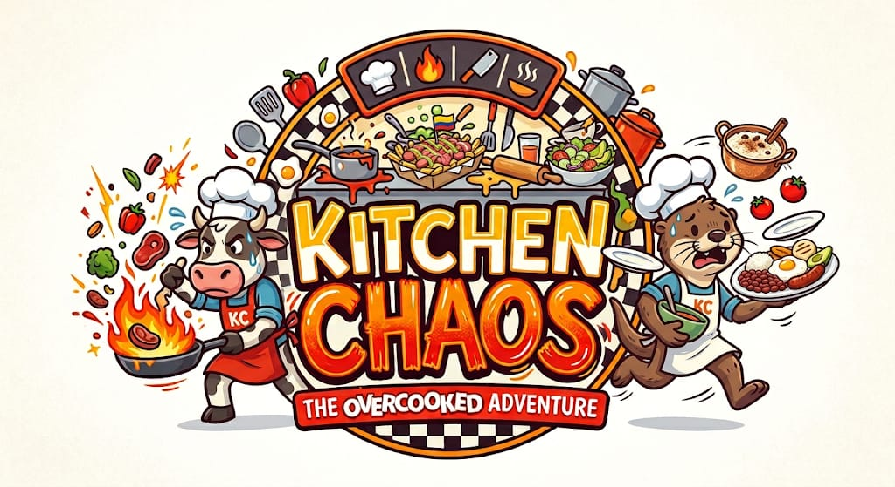
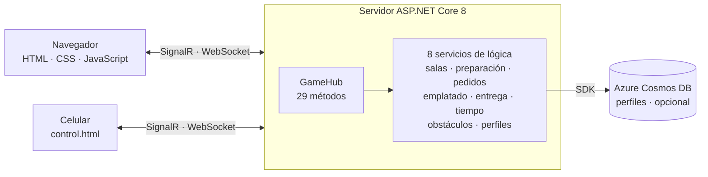
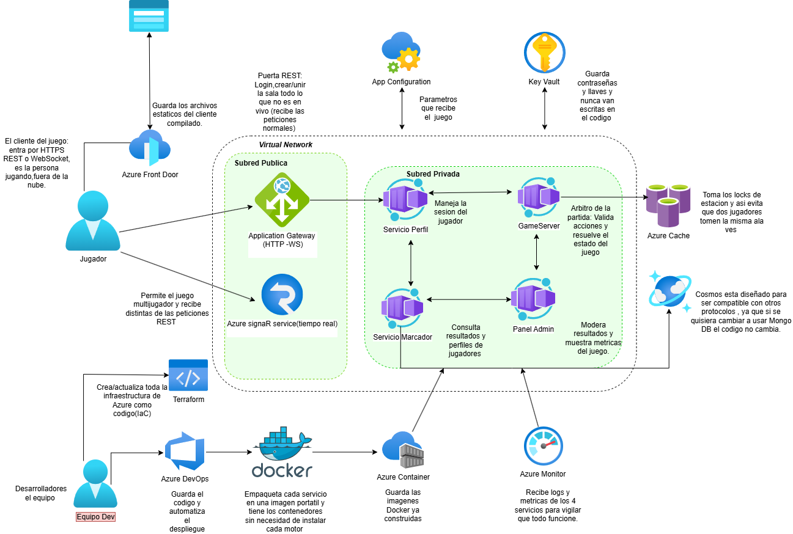
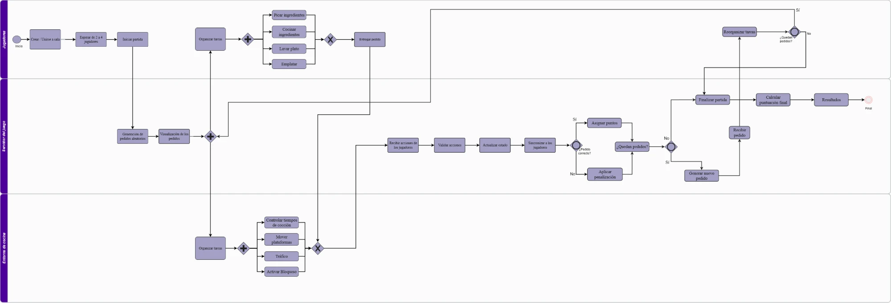

<p align="center">
  
</p>

# Kitchen Chaos

Juego cooperativo de cocina 2D en tiempo real — proyecto de ARSW enfocado en concurrencia y sincronización multijugador.


**Release 1 · 17 de octubre de 2026** · .NET 8 · ASP.NET Core SignalR

## Contenido

1. [¿Qué es Kitchen Chaos?](#qué-es-kitchen-chaos)
2. [Estado del proyecto](#estado-del-proyecto)
3. [Cómo se juega](#cómo-se-juega)
4. [Arquitectura](#arquitectura)
5. [Tecnologías](#tecnologías)
6. [Instalación y ejecución](#instalación-y-ejecución)
7. [Observabilidad y pruebas de carga](#observabilidad-y-pruebas-de-carga)
8. [Estructura del repositorio](#estructura-del-repositorio)
9. [Organización del trabajo](#organización-del-trabajo)
10. [Equipo](#equipo)
11. [Uso de herramientas de IA](#uso-de-herramientas-de-ia)

---

## ¿Qué es Kitchen Chaos?

Es un juego de cocina cooperativo, inspirado en Overcooked, que se juega en el navegador sin instalar nada. De **2 a 4 jugadores** comparten una misma cocina: llega un pedido con su cronómetro, y el equipo tiene que preparar los ingredientes, armar el plato y entregarlo antes de que se acabe el tiempo.

El objetivo del curso es la **concurrencia y la sincronización**: varios jugadores actúan a la vez sobre los mismos recursos (estaciones, ingredientes, platos, pedidos) y el estado de la partida tiene que mantenerse consistente para todos.

**Un pedido, paso a paso**

1. Llega un pedido con los ingredientes que lleva y su propio cronómetro.
2. Los jugadores toman los ingredientes de sus estaciones y los preparan: **picar**, **hervir** o **freír**. Si se dejan demasiado en el fuego, se queman y hay que tirarlos.
3. Se recoge un plato vacío, se arma el pedido y se entrega en la ventanilla. El plato sucio se lava.
4. Cada entrega correcta suma puntos para todo el equipo. Al terminar los 5 minutos del nivel, el puntaje se convierte en estrellas.

### Niveles

Cada nivel es un plato colombiano con su propio mapa, estaciones, recetas y puntos de partida.

| Nivel | Plato | Ingredientes | Preparación |
|---|---|---|---|
| 1 | Arroz con leche | leche, arroz, leche condensada, uvas pasas | hervir leche y arroz |
| 2 | Ensalada | tomate, lechuga, pepino, cebolla | picar |
| 3 | Salchipapa | salchicha, papa, pollo, queso, salsa roja, salsa blanca | freír y picar |
| 4 | Bandeja paisa | frijoles, carne, arroz, plátano, huevo, aguacate, chicharrón | hervir, freír y picar |

Hay 11 recetas jugables entre los 4 niveles. El nivel 5 ("todos los platos") tiene sus recetas definidas pero todavía no tiene mapa.

### Puntaje

| Evento | Puntos |
|---|---|
| Entrega correcta | +100 |
| Entrega incorrecta | −25 |
| Pedido que vence sin entregar (45 s) | −20 |

Cada nivel dura **300 segundos** y el servidor calcula las estrellas según el puntaje final.

---

## Estado del proyecto

**Release 1** reúne todo lo que está construido y funcionando en la rama `develop`.

**Incluye**

- Salas multijugador de 2 a 4 jugadores, con código de 4 dígitos y 8 personajes para elegir.
- Cocina completa: recoger, picar, hervir, freír, emplatar (con plato físico), entregar y lavar.
- Niveles 1 a 4 con sus mapas, recetas y selección de nivel por parte del anfitrión.
- Movimiento con colisiones contra paredes y entre jugadores.
- Cronómetros de nivel y de pedido controlados por el servidor, puntaje compartido y estrellas.
- Pausa para todos, siguiente nivel sin cerrar la sala y control desde el celular.

**Problemas conocidos**

- El apagón del nivel 3 y el viento del nivel 4 están programados en `ObstacleService`, pero todavía no se activan.
- La pausa congela la pantalla de los jugadores, pero el reloj del servidor sigue corriendo.
- Para repetir un nivel hay que crear una sala nueva; el botón de siguiente nivel aparece al terminar el nivel.
- Todos los niveles se pueden elegir desde el inicio (el desbloqueo por estrellas queda pendiente).
- El perfil de jugador existe en el servidor (Cosmos DB), pero la pantalla del juego todavía no lo usa.
- Si un jugador pierde la conexión, al volver entra como jugador nuevo y no recupera su lugar.
- El juego corre en local; el despliegue en Azure no está incluido.
- No hay pruebas automatizadas todavía.

**Release 2 (Sprint 7, del 19 al 25 de octubre)**: despliegue en Azure, reconexión con estado, perfil de jugador en la pantalla, bloqueo con Azure Cache, pruebas de concurrencia y de carga, CI, nivel 5, y activar los obstáculos y la pausa real en el servidor.

---

## Cómo se juega

### Empezar una partida

1. Un jugador escribe su nombre, elige personaje y pulsa **Crear sala**. Aparece un código de 4 dígitos.
2. Los demás jugadores escriben su nombre, el código y pulsan **Unirse a sala**.
3. Cuando hay al menos 2 jugadores, el anfitrión elige el nivel y pulsa **Iniciar partida**.

### Controles

| Acción | Teclado |
|---|---|
| Moverse | Flechas o `W` `A` `S` `D` |
| Agarrar o usar lo que tengas más cerca (ingrediente, estación, plato) | `Espacio` |
| Pausar o reanudar | `P` |

También se puede usar el mouse: cada estación del mapa responde al click. Los ingredientes que tienes en la mano aparecen debajo del tablero con el botón de la acción que toca (**Picar**, **Hervir**, **Freír**, **Retirar**).

### Control desde el celular

El celular puede funcionar como control remoto de un jugador.

1. En la partida, pulsa **Vincular celular** en el computador. Aparece un código de 6 dígitos.
2. En el celular, abre `http://<IP-del-computador>:5129/control.html` y escribe el código.
3. El celular muestra los botones de movimiento e interacción, el inventario, el plato, el puntaje y a los compañeros, y permite pausar.

Para que el celular pueda conectarse, el servidor tiene que escuchar en la red local y el celular debe estar en la misma red Wi-Fi. Mira [Jugar con el celular](#jugar-con-el-celular) en la sección de instalación.

---

## Arquitectura

### Arquitectura del Release 1: monolito en capas

Hoy el juego es un **monolito**: una sola aplicación ASP.NET Core 8 que sirve la página del juego, atiende la conexión SignalR y ejecuta toda la lógica. Se despliega como un único proceso (o un único contenedor). La única dependencia externa es Azure Cosmos DB, y es opcional.



**Quién decide qué.** El servidor manda en todo lo que se puede discutir: ingredientes, pedidos, platos, tiempo y puntaje. El movimiento se calcula en cada navegador (incluidas las colisiones) y se reparte a los demás por la misma conexión; el servidor solo lo retransmite.

**Componentes del servidor** (`src/KitchenChaos.Server`)

| Componente | Responsabilidad |
|---|---|
| `Hubs/GameHub.cs` | Punto de entrada de SignalR: recibe las acciones de los jugadores y emite los eventos a la sala |
| `RoomService` | Salas, jugadores, cupo de 4 y nivel elegido |
| `PreparationService` | Estaciones, ingredientes, picar, hervir, freír, quemado y reabastecimiento |
| `OrderService` | Recetas por nivel, generación y validación de pedidos |
| `PlatingService` | Platos físicos, emplatado y lavado |
| `DeliveryService` | Entrega de platos, puntos y penalización |
| `TimerService` | Cronómetro del nivel (300 s) y del pedido (45 s), estrellas y fin de nivel |
| `ObstacleService` | Apagón (nivel 3) y ráfagas de viento (nivel 4) |
| `PlayerProfileService` | Perfil del jugador, guardado en Cosmos DB |

### Concurrencia

Es la parte central del proyecto. Todo el estado de la partida vive en memoria, en un solo proceso, así que se protege con bloqueos y colecciones concurrentes:

- **Lock por estación.** Si dos jugadores intentan tomar el mismo ingrediente a la vez, el servidor procesa las solicitudes de a una: solo una tiene éxito y la otra recibe "Otro jugador ya tomó este ingrediente" con el estado actualizado.
- **Lock por sala.** El cupo de 4 jugadores y el inicio de la partida se validan bajo lock, para que dos entradas simultáneas no dejen una sala con 5 jugadores ni la inicien dos veces.
- **Colecciones concurrentes.** Salas, estaciones, ingredientes, platos, pedidos y temporizadores viven en `ConcurrentDictionary`, con una entrada por sala.
- **Tiempo en el servidor.** Los temporizadores de nivel y de pedido corren en el servidor y se transmiten a todos, de modo que el nivel avanza aunque un cliente se retrase.
- **Posiciones.** Se difunden mientras alguien se mueve y se fuerza una última al detenerse. Un latido de un segundo evita que un jugador quede congelado en la pantalla de los demás.

**Límite conocido:** como el estado está en memoria, hoy no se puede escalar a varios servidores (dos instancias no compartirían salas ni locks). Para eso el diseño prevé Azure Cache (ver abajo).

### Arquitectura objetivo en Azure

Este es el diseño al que apuntamos para el despliegue en la nube. **No está implementado todavía**: el Release 1 corre como el monolito descrito arriba y el despliegue es parte del Release 2.

<p align="center">
  
</p>

El jugador entra por **Azure Front Door**, que sirve los archivos estáticos del cliente desde un almacenamiento. Las peticiones normales (crear o unir una sala) pasan por un **Application Gateway** (HTTP y WebSocket) en la subred pública de una red virtual, y el juego en tiempo real viaja por **Azure SignalR Service**. En la subred privada corren los servicios en **Azure Container Apps**:

| Servicio | Función |
|---|---|
| Servicio Perfil | Maneja la sesión y el perfil del jugador |
| GameServer | Árbitro de la partida: valida acciones y resuelve el estado del juego |
| Servicio Marcador | Consulta resultados y perfiles de jugadores |
| Panel Admin | Modera resultados y muestra métricas del juego |

Alrededor: **Azure Cache** toma los locks de estación (para que dos jugadores no tomen el mismo ingrediente), **Cosmos DB** guarda los datos, **App Configuration** entrega los parámetros y **Key Vault** guarda las contraseñas y llaves para que nunca estén en el código. **Azure Monitor** recibe logs y métricas de los servicios. Del lado del equipo, **Azure DevOps** guarda el código y automatiza el despliegue, **Docker** empaqueta cada servicio en una imagen que se guarda en **Azure Container Registry**, y **Terraform** crea y actualiza la infraestructura como código.

**Del diseño al Release 1**

| Diseño objetivo | Release 1 | Pendiente |
|---|---|---|
| 4 servicios (Perfil, GameServer, Marcador, Admin) en Container Apps | Un monolito con servicios internos; no existen Marcador ni Panel Admin | Backlog |
| Azure SignalR Service | SignalR de ASP.NET Core dentro del servidor | Historia #9 |
| Locks en Azure Cache | Locks en memoria | Historia #34 |
| App Configuration y Key Vault | `appsettings.json` | Historia #10 |
| Front Door, Application Gateway y red virtual | No | Historias #8 y #68 |
| Azure Monitor | No | Historia #67 |
| Terraform y pipeline de CI | No | Historias #66 y #68 |
| Cosmos DB | Servidor listo; la pantalla aún no lo usa | Historias #12 y #13 |

### Flujo del juego

El proceso de una partida entre los jugadores, el servidor y el entorno de la cocina. Es el diseño original: los obstáculos del entorno (plataformas, tráfico, bloqueo) se reemplazaron por el apagón y el viento, que están programados pero sin activar.

<p align="center">
  
</p>

---

## Tecnologías

| Área | Tecnología | Uso |
|---|---|---|
| Lenguaje | C# y .NET 8 | Servidor y lógica del juego |
| Tiempo real | ASP.NET Core SignalR | Hub en `/gamehub` sobre WebSocket; la librería cliente 8.0.0 se carga desde cdnjs |
| Frontend | HTML, CSS y JavaScript | Sin framework: una página para jugar (`index.html`) y otra para el control móvil (`control.html`) |
| Datos | Azure Cosmos DB | Perfiles de jugador (SDK `Microsoft.Azure.Cosmos` 3.38.1); emulador local en Docker |
| Contenedores | Docker | `Dockerfile` en dos etapas y `docker-compose.yml` para el emulador de Cosmos |
| Observabilidad | prometheus-net, Prometheus y Grafana | El juego expone `/metrics`; Prometheus las guarda y Grafana las dibuja en un tablero ya configurado |
| Pruebas de carga | k6 | Simula salas de dos jugadores por SignalR (carga, estrés, pico y duración) |
| Código | Git y GitHub | Ramas `feature/*`, pull requests a `develop` y commits con el número de historia |
| Gestión | Azure DevOps | Boards (épicas, features e historias), sprints semanales y Wiki |
| Tipografías | Google Fonts | Fraunces, Source Sans 3 e IBM Plex Mono |

---

## Instalación y ejecución

### Requisitos

- [.NET 8 SDK](https://dotnet.microsoft.com/download/dotnet/8.0)
- Un navegador moderno (Chrome, Edge o Firefox)
- **Conexión a internet:** la librería cliente de SignalR y las tipografías se cargan desde un CDN, así que sin internet la pantalla del juego no funciona
- Opcional: [Docker Desktop](https://www.docker.com/products/docker-desktop/), solo si quieres usar el emulador de Cosmos DB

### Correrlo en local

```bash
git clone https://github.com/ARSW-LABORATORIOS/kitchen-chaos.git
cd kitchen-chaos/src/KitchenChaos.Server
dotnet run
```

Abre `http://localhost:5129` en el navegador. Para probar el multijugador, abre el juego en **dos ventanas**: una crea la sala y la otra se une con el código.

No necesitas Docker ni Cosmos DB para jugar. Si Cosmos no está disponible, el servidor lo avisa en la consola ("Cosmos DB no disponible…") y arranca igual; solo los perfiles de jugador no funcionan.

### Cosmos DB con el emulador (opcional)

```bash
docker compose up -d
```

Levanta el emulador de Cosmos DB (puertos 8081, 8080 y 1234). La configuración por defecto de `appsettings.json` ya apunta a él (`https://localhost:8081`). Al arrancar, el servidor crea la base de datos y el contenedor si no existen.

Para usar otra cuenta de Cosmos, cambia la sección `CosmosDb` de `src/KitchenChaos.Server/appsettings.json` o define las variables de entorno `CosmosDb__AccountEndpoint`, `CosmosDb__AccountKey`, `CosmosDb__DatabaseName` y `CosmosDb__ContainerName`. No subas llaves reales al repositorio.

### Jugar con el celular

Para que el celular pueda abrir el control, el servidor debe escuchar en la red local:

```bash
dotnet run --urls "http://0.0.0.0:5129"
```

Busca la IP de tu computador (por ejemplo con `ipconfig` en Windows) y, desde el celular en la misma red Wi-Fi, abre `http://<esa-IP>:5129/control.html`. Si no conecta, revisa que el firewall permita el puerto 5129.

### Con Docker (opcional)

El repositorio incluye un `Dockerfile` de dos etapas (SDK para compilar, runtime para ejecutar) que expone el puerto 8080:

```bash
docker build -t kitchen-chaos .
docker run -p 5129:8080 kitchen-chaos
```

Para el Release 1 el camino recomendado y probado es `dotnet run`.

### Problemas frecuentes

| Problema | Qué hacer |
|---|---|
| La pantalla carga pero no pasa nada | Revisa tu conexión a internet (CDN de SignalR) y recarga con `Ctrl + F5` |
| `dotnet build` falla por un archivo bloqueado (`MSB3027`) | El servidor sigue corriendo: deténlo con `Ctrl + C` y vuelve a compilar |
| El puerto 5129 está ocupado | Cierra el otro proceso o usa `dotnet run --urls "http://localhost:5200"` |
| Cambié un archivo de `wwwroot` y no se ve | Detén y vuelve a iniciar el servidor |
| Aviso "Cosmos DB no disponible" | Es normal sin Docker; el juego funciona igual |

### Herramienta para pintar paredes de un mapa

`tools/wall-painter.html` es una página suelta, sin servidor, para definir las colisiones de un mapa nuevo: abre el archivo en el navegador, sube la imagen del mapa, marca las celdas de piso y copia el código generado dentro de `WALKABLE_CELLS` en `index.html`. Todos los niveles comparten la misma grilla de 24 columnas por 14 filas.

---

## Observabilidad y pruebas de carga

El servidor expone sus métricas en `/metrics` (formato Prometheus) y una ruta `/ready` para saber si responde. Prometheus las lee cada 5 segundos, Grafana las dibuja y k6 genera carga para ver cómo reacciona el juego.

### Qué se mide

- **Servicio:** si Prometheus lee el juego, si responde `/ready` (sonda de disponibilidad) y el porcentaje de disponibilidad en 5 minutos.
- **Rendimiento:** promedio y P95 de cada llamada al `GameHub`, llamadas por segundo, porcentaje de errores y CPU del proceso. Todas las llamadas al hub se miden solas con un filtro de SignalR (`MetricsHubFilter`).
- **Concurrencia:** `kc_station_takes_total{result="conflict"}` cuenta las veces que dos jugadores quisieron la misma estación y el `lock` dejó pasar solo a uno. Algo parecido se mide con `kc_room_joins_total{result="full"}` para el cupo de la sala.
- **Juego:** jugadores conectados, salas activas, partidas iniciadas, pedidos entregados y vencidos, pasos de cocina y platos emplatados.

Las métricas propias están todas en `src/KitchenChaos.Server/Observability/GameMetrics.cs`. Si agregas una acción nueva al juego, el hub la mide sola; si quieres una métrica propia, súmala ahí.

### Levantar Prometheus y Grafana

Con Docker Desktop abierto y el juego corriendo (`dotnet run`, puerto 5129):

```bash
cd observability
docker compose up -d
```

- Grafana: `http://localhost:3000` (usuario `admin`, contraseña `admin`). El tablero **Kitchen Chaos Observabilidad** ya aparece configurado.
- Prometheus: `http://localhost:9090`.
- Para apagar: `docker compose down` (el tablero no se pierde, está guardado como archivo).

Si cambias el tablero desde Grafana, expórtalo (`Share → Export → JSON`) y reemplaza `observability/grafana/dashboards/kitchen-chaos.json`; si no, el cambio se pierde al recargarlo.

### Con el juego también en Docker

Para medir sin pasar por la red de Docker Desktop hacia tu computador, el juego puede correr dentro de Docker, en la misma red que Prometheus y k6:

```bash
cd observability
docker compose -f docker-compose.yml -f docker-compose.game.yml up -d --build
```

El juego queda en `http://localhost:5130` y Grafana en `http://localhost:3000`.

### Pruebas de carga con k6

El script está en `tests/load/kitchen-chaos.js` y tiene cinco escenarios: `humo`, `carga`, `estres`, `pico` y `duracion`. Cada iteración simula una sala de dos jugadores que piden **la misma estación a la vez**, y la prueba exige que gane exactamente uno. Los umbrales son p95 menor a 500 ms, errores menores al 1 % y un solo ganador por estación.

Los comandos de cada escenario, con el juego en tu computador o en Docker, están en [tests/load/README.md](tests/load/README.md).

### Resultados de las pruebas

| Escenario | Resultado |
|---|---|
| `carga` (2 salas por segundo, 1 min) | 118 salas, 0 errores, p95 de 31 ms, un solo ganador en todas |
| `pico` (hasta 25 salas por segundo, juego en el computador) | 378 salas, 0 errores del hub, p95 de 20 ms, un solo ganador en todas; 2 conexiones expiraron y k6 no alcanzó a iniciar 47 salas |
| `estres` (hasta 12 salas por segundo, juego en Docker) | 929 salas, 0 fallos, p95 de 4 ms, un solo ganador en todas |

Con el juego corriendo en el computador y k6 en Docker, el estrés ya fallaba con 12 salas por segundo (33 de unas 915 salas, por `handshake` sin respuesta). El servidor no registró errores y, con el juego y k6 en la misma red de Docker, esos fallos desaparecieron, así que el límite estaba en la red de Docker Desktop hacia el computador y no en el juego.

Las pruebas también encontraron un error real: al quedar una sala vacía, el servidor no paraba sus temporizadores y seguían generando pedidos vencidos de una sala que ya no existía (hasta unos 2000 por minuto bajo carga). Ya está corregido en `GameHub.OnDisconnectedAsync`.

---

## Estructura del repositorio

```
.
├── docs/                          logo y diagramas del README
├── src/KitchenChaos.Server/
│   ├── Hubs/GameHub.cs            punto de entrada de SignalR
│   ├── Models/                    sala, jugador, ingrediente, pedido, plato, receta, perfil
│   ├── Services/                  lógica del juego (8 servicios)
│   ├── Repositories/              acceso a Cosmos DB
│   ├── Observability/             métricas del juego (GameMetrics) y filtro que mide el hub
│   ├── wwwroot/
│   │   ├── index.html             pantalla del juego
│   │   ├── control.html           control desde el celular
│   │   ├── css/game.css
│   │   └── images/                mapas de los niveles, personajes y logo
│   ├── Program.cs                 configuración del servidor
│   └── appsettings.json
├── observability/                 Prometheus, Grafana, sonda de disponibilidad y tablero (JSON)
├── tests/load/                    pruebas de carga con k6
├── tools/wall-painter.html        herramienta para pintar paredes de los mapas
├── Dockerfile
├── docker-compose.yml             emulador de Cosmos DB
└── KitchenChaos.sln
```

---

## Organización del trabajo

El proyecto se gestionó en **Azure DevOps** con una jerarquía de épicas, features e historias de usuario (cada una con criterios de aceptación en formato Dado, Cuando, Entonces), repartida en **siete sprints semanales** del 7 de septiembre al 25 de octubre de 2026.

| Release | Sprints | Contenido |
|---|---|---|
| Release 1 | 1 a 6 (7 sep – 18 oct) | 36 historias y 113 puntos: sala, cocina completa, pedidos, movimiento, niveles 1 a 4, estrellas y control móvil |
| Release 2 | 7 (19 – 25 oct) | 20 historias: despliegue, reconexión, perfil, pruebas, CI y nivel 5 |

En Azure Boards, las historias entregadas llevan la etiqueta `Release 1`.

### Ramas

- `main`: solo se actualiza en releases cerrados.
- `develop`: rama de integración, donde se juntan las features antes de pasar a `main`.
- `feature/*`: una por persona o historia, se crean a partir de `develop` y entran por pull request.

### Convención de commits

Incluir el ID de la historia de Azure Boards en el mensaje:

```bash
git commit -m "feat: estrellas por nivel y recetas de los niveles 3 a 5 AB#84"
```

Azure DevOps enlaza el commit con su historia automáticamente.

---

## Equipo

| Integrante | Historias | Contribución principal |
|---|---|---|
| Mabel Bernal | 16 | Salas, preparación de ingredientes y recetas, movimiento y colisiones, personajes, hervir y freír, herramienta de paredes |
| Nicolás Prieto | 8 | Pedidos dinámicos, temporizadores, puntaje y fin de nivel, niveles 3 y 4, estrellas, pausa y siguiente nivel |
| Juan Eduardo Vera | 12 | Pantalla inicial y sala de espera, emplatar, entregar y lavar, tablero y HUD, mapas de los niveles, plato físico y control móvil |

---

## Uso de herramientas de IA

Usamos **Claude** y **Amazon Q** como apoyo para construir y documentar el proyecto. Todo el código y el contenido generado con ayuda de IA fue revisado y ajustado por el equipo antes de incluirlo; la responsabilidad sobre las decisiones de arquitectura y el resultado final es nuestra.

